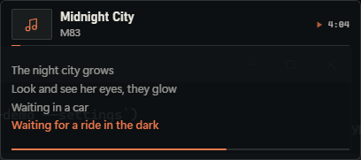

# Iceberg

[](LICENSE)

A tiny, transparent now-playing and lyrics widget for Windows. It reads the current song from Windows' own media session, fetches synced lyrics from LRCLIB, and stays out of the way.

No Spotify login. No API keys. No account. No telemetry. One background process when idle.



## What it does

- Frameless, always-on-top widget with three modes: Island, Card, and Lyrics only
- Time-synced lyrics from [LRCLIB](https://lrclib.net) with automatic caching
- Global hotkeys, tray controls, click-through lock, edge snapping, per-monitor position memory
- Native acrylic/mica as an option, no CSS backdrop blur
- Settings window with live preview, themes, offsets, LRCLIB search, `.lrc` import, and diagnostics
- Starts as a tray-only process; the WebView2 window exists only while it is needed
- Visual direction is documented in [docs/DESIGN.md](docs/DESIGN.md)

## Install

Grab the latest `Iceberg_x.y.z_x64-setup.exe` from [Releases](https://github.com/h4nxxlmao/iceberg/releases) and run it. The installer is per-user and does not need administrator rights.

The build is not code-signed yet, so Windows SmartScreen may show a warning. Choose **More info → Run anyway** only if you downloaded it from this repository.

Iceberg needs the Microsoft Edge WebView2 Runtime. Windows 11 includes it; the installer uses the small online bootstrapper when it is missing.

## Build from source

Requirements: Windows 10/11 x64, Rust stable, Node.js LTS, and the WebView2 runtime.

```powershell
cd app
npm ci
npm run tauri build
```

The installer is written to `app/src-tauri/target/release/bundle/nsis/`. The executable is at `app/src-tauri/target/release/iceberg.exe`.

For development:

```powershell
cd app
npm run tauri dev
```

Do not use a bare `cargo build --release` when you want a standalone executable: without Tauri's `custom-protocol` feature the debug URL is embedded instead of the frontend. The Tauri CLI enables it for you.

## Using it

The app starts in the tray with no window. When a player exposes a Windows media session, the widget appears. When nothing is playing it goes away after the configured idle timeout.

Left-click the tray icon to show or hide the widget. Right-click for mode, theme, offset, click-through, autostart, settings, and quit.

Default hotkeys (configurable in Settings):

| Action | Shortcut |
| --- | --- |
| Show / hide | `Ctrl+Alt+I` |
| Click-through lock | `Ctrl+Alt+L` |
| Lyrics +100 ms | `Ctrl+Alt+Right` |
| Lyrics −100 ms | `Ctrl+Alt+Left` |
| Cycle mode | `Ctrl+Alt+M` |
| Quick peek | `Ctrl+Alt+P` |
| Settings | `Ctrl+Alt+,` |

Click a lyric line to copy it. Drag any non-interactive part of the widget to move it; with edge snap enabled it snaps to the work-area edges and center. Positions are remembered per monitor.

## Performance

Measured on Windows 11 build 26300, WebView2 runtime 156, 8 logical cores, release build, default settings, no settings window open.

RAM is the **private working set** of `iceberg.exe` plus every descendant process, read from `Win32_PerfFormattedData_PerfProc_Process`. CPU is process CPU time over a measured wall-clock window. The CPU figure is steady state after the first lyric transitions. The first 12 seconds after a cold launch include WebView2 setup and the demo's first line changes, so that window can read above 1%.

| State | Target | Measured |
| --- | --- | --- |
| Tray only, nothing playing | under 15 MB | **1.7 MB** |
| Widget visible and playing | under 70 MB | **59.2 MB** |
| Hidden / paused | under 30 MB | **11.0 MB** after teardown |
| CPU while lyrics show | under 1% | **0.09 CPU-seconds / 12 s** (≈0.78% of one core, ≈0.10% total) |
| Executable | under 5 MB | **4.07 MB** |
| NSIS installer | under 8 MB | **1.69 MiB** |

How the budget is met:

- No window and no WebView2 process until playback starts. Idle CPU measured 0.03 CPU-seconds over 10 seconds.
- WebView2 runs single-process with GPU disabled, the two flags that made the largest difference on this machine.
- The window is hidden, suspended, then destroyed after 5 seconds. The process tree is trimmed with `EmptyWorkingSet` on hide, after teardown, and when the widget is destroyed.
- Native acrylic/mica is off by default. It works, but adds DWM/compositor work; enable it in Appearance if you want the blur.
- There is no equalizer. The active lyric and the play glyph carry the state.
- The progress bar steps every 10 seconds with a 60 ms transition. A single long-running transition cost about 28% of one core in this transparent window, so it was cut. There are no per-frame loops.
- Lyrics render only the visible 3–5 lines. Sync is one timer to the next line, not a frame loop.
- The WebView2 cache is capped at 16 MB by flag. The profile is trimmed at startup and on exit if it exceeds 30 MB. Lyrics and artwork caches are capped at 30 MB with oldest-first eviction.

### WebView2 flags: kept and rejected

Kept:

| Flag | Reason |
| --- | --- |
| `--single-process` | Largest RAM saving. The page is local-only and served under a strict CSP. |
| `--disable-gpu` | Saves about 10 MB; transparency and the reduced animation set still render correctly. |
| `--disable-background-networking`, `--disable-extensions`, `--disable-sync`, `--disable-default-apps`, `--no-pings` | Removes work a widget does not need. |
| `--disable-features=msSmartScreenProtection,msWebOOUI,msPdfOOUI,TranslateUI` | Replaces Wry's defaults, which are lost when custom browser arguments are supplied. |
| `--renderer-process-limit=1` | Harmless here and useful if single-process is removed. |
| `--js-flags=--max-old-space-size=32` | Caps V8's old space; the frontend is tiny. |
| `--disk-cache-size=16777216` | Keeps the profile from growing without bound. |

Rejected:

| Change | Result |
| --- | --- |
| Default Acrylic/Mica | Works, but adds compositor CPU (0.33 CPU-seconds / 12 s vs 0.08); kept as an option rather than the default. |
| `--enable-low-end-device-mode` | Tested as a candidate; did not reduce private working set in our baseline, so it is not used. |
| `--in-process-gpu` | Works, but 86.3 MB visible; above budget. |
| Continuous progress transition | 2.25 CPU-seconds per 8 seconds (about 28% of one core) in this transparent window. Replaced with stepped updates. |
| Animated equalizer | Same problem; cut. The static mark was removed as well. |
| `--disable-breakpad`, `--disable-crash-reporter` | Crashpad still starts; no measurable gain. |

If a future WebView2 update breaks single-process mode, remove `--single-process` from `DEFAULT_WEBVIEW_ARGS` in `app/src-tauri/src/window.rs`. Expect roughly 10 MB more RAM while the widget is visible.

## Configuration and data

| Path | Contents |
| --- | --- |
| `%APPDATA%\Iceberg\config.json` | Settings, per-song offsets, theme |
| `%LOCALAPPDATA%\Iceberg\cache` | Lyrics and artwork cache |
| `%LOCALAPPDATA%\Iceberg\webview` | Shared WebView2 profile |
| `%LOCALAPPDATA%\Iceberg\window.json` | Position per monitor |

The config is validated on load and on every save. Unknown or invalid values fall back to defaults instead of crashing the app.

**Portable mode:** put an empty `portable.txt` next to `iceberg.exe`. Config and cache are then stored in that folder (`config.json` and `data/`). You can also pass `--portable`.

## Privacy and security

- The only network requests Iceberg itself makes go to `lrclib.net`, over HTTPS, with a 5 second timeout and response size limits. WebView2 is launched with background networking disabled and loads no remote content.
- Lyrics, titles, artists, and artwork are treated as untrusted text/data. Lyrics are rendered with Svelte text bindings, never HTML.
- The webview loads only bundled local assets under a strict CSP: no remote content, no eval, no inline scripts, no asset protocol.
- Tauri capabilities are limited to events and window dragging.
- No telemetry, analytics, accounts, or crash reporting from Iceberg itself.

See [SECURITY.md](SECURITY.md) for reporting.

## Known limitations

- Single-process WebView2 is not an officially supported Microsoft configuration. It is used because it is the only way this widget met its RAM target on the build machine. The content is local and the app never navigates.
- The progress bar updates in 10 second steps. It is accurate and cheap, but it is not a continuously moving animation.
- Long titles and artists ellipsize. They scroll only while hovered, so the CPU budget is not spent on an idle marquee.
- Acrylic/Mica work but add compositor CPU; they are off by default. The measured acrylic run used 0.33 CPU-seconds per 12 seconds.
- SMTC does not expose the next track, so lyrics cannot be prefetched for it.
- Album-art accent uses a simple dominant-color sample, not a full palette.
- The settings window adds memory while it is open; the widget budget is measured with settings closed.
- Lyrics are best-effort. The wrong-lyrics search and `.lrc` import exist for that reason.

## Project layout

```
app/                 Tauri 2 desktop app
  src/               Svelte widget and settings UI
  src-tauri/src/     Rust backend (SMTC, LRCLIB, cache, window, tray, perf)
site/                local promotional site, not part of the published app
```

The Rust side is split into `smtc.rs` (Windows media events), `lyrics.rs` (LRCLIB + LRC parsing), `cache.rs`, `window.rs`, `tray.rs`, `hotkeys.rs`, `perf.rs`, `config.rs`, and `timers.rs`.

## Contributing

Read [CONTRIBUTING.md](CONTRIBUTING.md). Small, focused changes; run fmt, clippy, tests, frontend typecheck, and build before opening a pull request.

## License

MIT. See [LICENSE](LICENSE).
