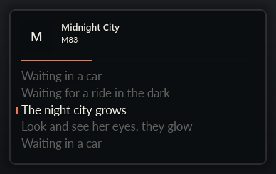
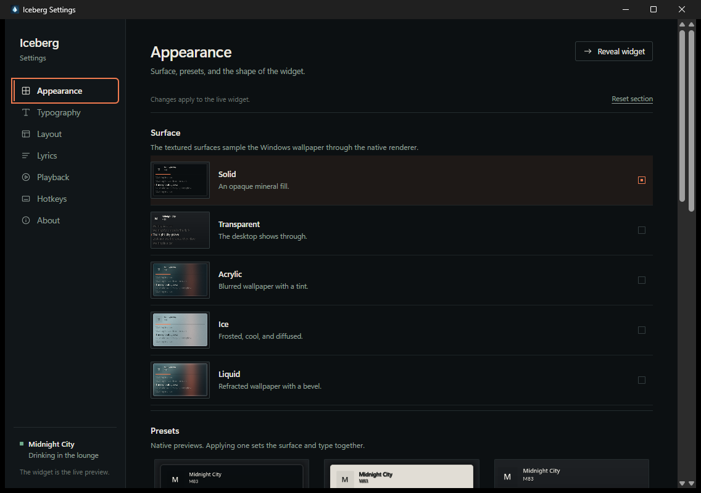
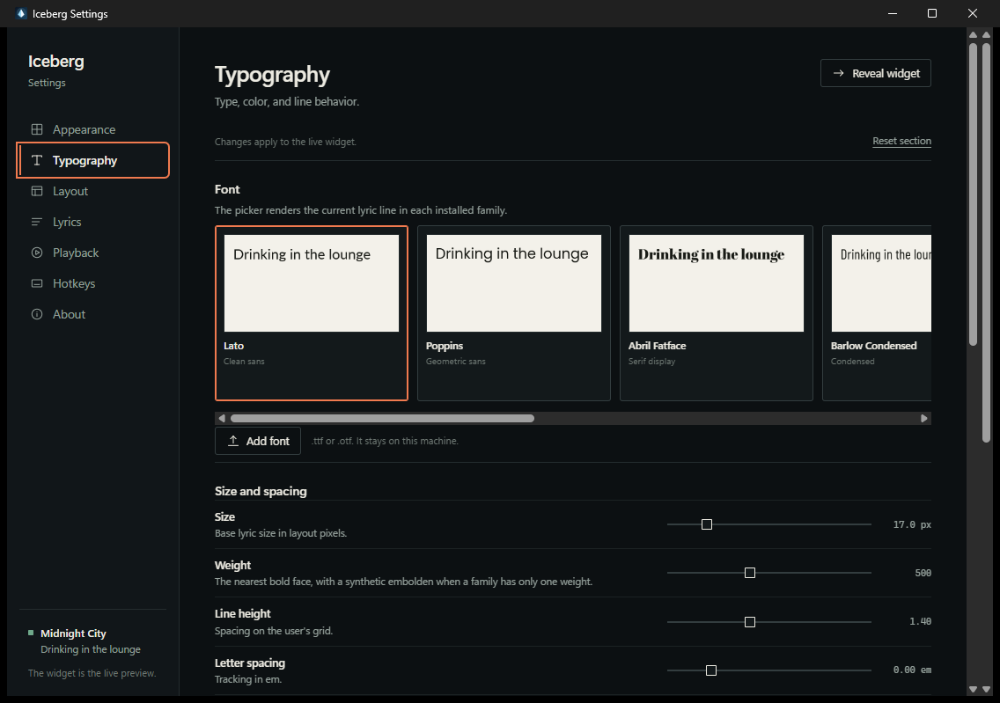

# Iceberg

[](LICENSE)

A tiny, transparent now-playing and synced-lyrics widget for Windows. It reads the current song from Windows' own media session, fetches synced lyrics from LRCLIB, and stays out of the way.

No Spotify login. No API keys. No account. No telemetry. No WebView in the widget.



Offscreen native render over a neutral review backdrop. The real widget is a transparent layered window on the desktop. The settings companion is a separate WebView2 process that exists only while you are editing settings.

## What it does

- Frameless, always-on-top native widget with Island, Card, and Lyrics modes
- Event-driven Windows SMTC now-playing; no polling loop
- Music source picker for Spotify, Apple Music, a custom SMTC app, or an explicit Any app. Browser and YouTube sessions are ignored by default.
- Time-synced lyrics from [LRCLIB](https://lrclib.net), with plain-text, instrumental, loading, empty, unsynced, and offline states. Settings can force a fresh lookup or copy the current line.
- Five surfaces: Solid, Transparent, Acrylic, Ice, and Liquid. The textured surfaces share one CPU wallpaper pipeline; there is no DWM acrylic.
- Slide, fade, and off transitions, plus the configured active color, inactive opacity, alignment, case, letter spacing, line height, shadow, and outline
- Eight bundled OFL families with lazy per-family loading, cap-height optical scaling, and baseline normalization
- Six presets, a story-style font picker, and `.ttf`/`.otf` upload in the settings companion
- Per-track lyric offsets and font overrides
- Tray show/hide, settings, click-through, mode cycling, and quit
- Global hotkeys: toggle, click-through, ±100 ms lyric offset, cycle mode, quick peek, and open settings
- Edge snapping and a remembered position for each monitor
- Pause auto-hide, fullscreen auto-hide, optional start with Windows, battery saver, and reduced motion
- Click-through is restored from the tray or its hotkey
- Tray-only mode creates no window, no WebView, and loads no font data until playback exists

The settings window is the real widget's preview: while it is open, the native widget shows the current track or a demo track. Closing Settings removes the preview and leaves the widget in the tray. Settings itself exits completely.





## Install

Download the current installer or portable ZIP from [GitHub Releases](https://github.com/h4nxxlmao/iceberg/releases).

- The installer is per-user and does not require administrator rights.
- The settings companion uses the Microsoft WebView2 runtime. Windows 11 includes it; the installer can fetch it on Windows 10.
- Windows builds are unsigned, so SmartScreen may show an “Unknown publisher” warning. Verify the SHA-256 checksum attached to the release before choosing **More info → Run anyway**.
- The portable ZIP contains `iceberg.exe`, `iceberg-settings.exe`, the fonts, presets, surface thumbnails, and icons. Run `iceberg-settings.exe` or `iceberg.exe`.

## Build from source

Requirements: Windows 10/11 x64, Rust stable 1.90 or newer, Node.js 22 LTS, and the WebView2 runtime for the settings window.

```powershell
cd app
npm --prefix settings ci
cargo xtask package
```

`cargo xtask package` builds the frontend, the release widget and settings executables, the portable folder at `app/dist/Iceberg`, and an NSIS installer under `app/target/release/bundle/nsis`. The installer step downloads the Tauri NSIS tool the first time and needs network access; the portable folder is produced before that step.

For a quick native run with the built-in demo:

```powershell
cargo run -p iceberg-widget -- --demo
cargo run -p iceberg-widget -- --demo --background=liquid
```

For the settings app in development, build the widget first so the settings can launch it, then run the Tauri dev server:

```powershell
cargo build -p iceberg-widget
npm --prefix settings run tauri -- dev --no-watch
```

The settings executable lives next to `iceberg.exe` in `app/target/debug`; the companion process looks for it there. In a packaged build, both executables and the assets are installed together.

Regenerate the native preset and surface thumbnails after changing presets or surfaces:

```powershell
cargo xtask
```

Render review screenshots with the synthetic wallpaper instead of the build machine's desktop:

```powershell
cargo run -p iceberg-widget -- --screenshot=../docs/phase-c
```

Run the warm transition benchmark:

```powershell
cargo run -p iceberg-widget -- --bench=../docs/phase-c/bench-100-acrylic.json --background=acrylic --scale=100
```

## Performance

The surface renderer is unchanged from the Phase C measurements. The final build adds the local settings pipe, fullscreen hook, global hotkeys, and tray actions; the release size and one-sample memory figures below include them. The table is the median of three release runs; total CPU is normalized across the build machine's 16 logical processors. Working set and private bytes are for `iceberg.exe`; there are no child processes while the widget is visible. The warm background column is the rebuild after a move settle with masks already warm; the value after the slash is the backdrop pipeline alone.

| Surface | Scale | Window | Transition CPU total | Idle | Working set / private | Warm background / pipeline |
| --- | ---: | ---: | ---: | ---: | ---: | ---: |
| Solid | 100% | 388 x 245 | 0.54% | 0% | 20.7 / 6.9 MB | 7.3 / 0 ms |
| Transparent | 100% | 388 x 233 | 0.54% | 0% | 20.6 / 6.9 MB | 3.2 / 0 ms |
| Acrylic | 100% | 388 x 245 | 0.61% | 0% | 24.0 / 9.6 MB | 54.4 / 30.2 ms |
| Ice | 100% | 388 x 245 | 0.54% | 0% | 24.0 / 9.6 MB | 38.5 / 15.8 ms |
| Liquid | 100% | 388 x 245 | 0.51% | 0% | 24.0 / 9.6 MB | 37.7 / 23.2 ms |
| Acrylic | 200% | 776 x 490 | 1.28% | 0% | 30.3 / 14.5 MB | 154.0 / 53.4 ms |
| Ice | 200% | 776 x 490 | 1.25% | 0% | 30.2 / 14.4 MB | 113.9 / 57.1 ms |
| Liquid | 200% | 776 x 490 | 1.52% | 0% | 30.3 / 15.1 MB | 207.5 / 103.9 ms |

- All transition CPU totals are under 3%; the highest one-core median is 24.25% at 200% Liquid. Full one-core ranges, raw JSON, and the surface previews are in [Phase C results](docs/phase-c/RESULTS.md).
- Background rebuilds during the 12 transitions: **0**. Idle CPU is 0% for every surface after the settle.
- The 200% Liquid rebuild is the most expensive opt-in surface. Solid is the default. Textured processing is capped at 400 px and sampled into the card; the 100% path is unchanged.
- The final Phase D/E release executable is **3.49 MiB**; settings companion **3.02 MiB**; NSIS installer **3.52 MiB**; portable ZIP **4.98 MiB**; bundled fonts **2.85 MiB**. All are inside the executable and installer budgets.
- A final visible demo sample measured **21.9 MB working set / 6.8 MB private**; a tray-only release sample measured **0.2 MB trimmed working set / 2.8 MB private**. These are single samples, not the median-of-three renderer table.
- Tray-only mode loads no wallpaper and no font data. Window teardown drops the wallpaper proxy and font cache.
- Real mixed-DPI monitor moves, Windows 10, and the 20-minute leak run are still on the verification list. The settings window's WebView2 process is separate and only exists while Settings is open.

## How the surfaces work

- **Solid** uses the configured color and opacity. **Transparent** leaves the actual desktop visible. **Acrylic**, **Ice**, and **Liquid** mirror the Windows wallpaper through one CPU pipeline: crop, blur, tint/frost/noise, optional liquid refraction and highlights, then an antialiased rounded shape.
- The wallpaper is read from the Windows wallpaper path, decoded with WIC, and kept as a 960 px proxy. Only a textured surface loads it. The proxy is cover-cropped to the monitor and window, so fit, tile, stretch, and span wallpaper modes are approximate.
- The backdrop is rebuilt after a 120 ms move settle, on resize, and on monitor change. The static card layer, title/artist masks, and text are cached.
- No DWM acrylic, `SetWindowCompositionAttribute`, or `DwmEnableBlurBehindWindow` is used. Live desktop capture is out of v1; the `live` backdrop source falls back to the wallpaper. Per-monitor wallpapers and wallpaper changes while the widget sits still are not mirrored yet.
- The review screenshots use a generated wallpaper so the build machine's desktop is not published.

## Fonts

The stock families are Lato, Poppins, Abril Fatface, Barlow Condensed, Amatic SC, Space Mono, Varela Round, and Lobster. Each is SIL Open Font License 1.1; licenses and sources are in [app/assets/fonts](app/assets/fonts/README.md).

Imported fonts are stored in `%LOCALAPPDATA%\Iceberg\fonts`. The core validates the file, rejects empty or oversized files, reads family/subfamily/metrics/variable axes, and falls back to Lato if a requested family cannot be resolved. Weight uses the family's bold face when available and a synthetic embolden above 600 when it is not; italic is a synthetic shear, so the control works for families without an italic file.

The settings font picker renders the current lyric line in every installed family. Font data is loaded one family at a time and the preview is the native glyph rasterizer, not a browser imitation of the widget.

Word timings from enhanced LRC are parsed but word-level highlighting is not implemented yet.

## Settings and configuration

| Path | Contents |
| --- | --- |
| `%APPDATA%\Iceberg\config.json` | Settings, per-track offsets and font overrides, per-monitor positions |
| `%LOCALAPPDATA%\Iceberg\cache` | Lyrics and artwork cache |
| `%LOCALAPPDATA%\Iceberg\fonts` | Imported font files |
| `%LOCALAPPDATA%\Iceberg\presets` | User preset folder reserved for a later release |
| `%LOCALAPPDATA%\Iceberg\widget.log` | Reserved diagnostic log path |

The config is versioned, migrated, and validated on load. Missing or invalid values fall back to defaults. Obsolete prototype-era config files are rewritten to the current schema at startup. Changes from the settings window are applied to the running widget over a per-session named pipe and saved immediately; closing the settings window closes the pipe and removes the preview.

Global hotkeys are editable in Settings. At least one modifier is required. If a shortcut is already used by another application, the widget leaves it unregistered and prints a diagnostic to its console.

## Privacy and security

- The only network requests Iceberg makes go to `lrclib.net` over HTTPS, with timeouts and response size limits.
- The textured surfaces read the current Windows wallpaper file locally through WIC. The widget does not capture other windows or the live desktop.
- Lyrics, titles, artists, artwork, and imported font names are untrusted. The native widget draws them as text; it contains no HTML or WebView. The settings window loads only bundled local assets under a strict CSP and escapes display text.
- The widget contains no telemetry or analytics. The settings companion has only the Tauri `core:default` permissions; it has no filesystem, shell, or arbitrary HTTP permission.
- The local settings pipe is scoped to the interactive Windows session and exposes only appearance commands. It does not expose files, secrets, network requests, or privilege changes.
- Autostart uses only the current user's `Run` key and can be turned off in Settings.
- Font files and config are validated at the boundary. Imported fonts are copied under generated names inside the app's own folder.

See [SECURITY.md](SECURITY.md) for reporting.

## Not done yet

- Windows 10 verification, two-monitor mixed-DPI testing, and the 20-minute leak run
- Word-level lyric highlighting
- Exact wallpaper fit/tile/span mapping, per-monitor wallpapers, and live wallpaper-change detection
- Live desktop capture
- A cheaper 200% Liquid rebuild; the current opt-in surface is the most expensive path

The old Tauri prototype under `app/src-tauri` is kept for reference only. Neither the widget nor the published settings companion uses it.

## Project layout

```
app/
  core/              shared config, SMTC, LRCLIB, cache, fonts, presets, IPC schema
  widget/            native layered widget, renderer, tray, hotkeys, wallpaper capture
  settings/          Tauri settings companion and vanilla TypeScript UI
  xtask/             native thumbnail and release packaging helper
  assets/            fonts, licenses, preset/surface thumbnails, tray icon
  src-tauri/         previous Tauri prototype (reference only)
docs/                renderer decision, phase screenshots, measurements
.github/             CI, release, and security workflows
```

## Contributing

Read [CONTRIBUTING.md](CONTRIBUTING.md). Run `cargo fmt --all --check`, `cargo clippy --workspace --all-targets -- -D warnings`, `cargo test --workspace`, and `npm --prefix settings run build` from `app` before opening a pull request.

## License

Iceberg is free software licensed under the **GNU General Public License, version 3 only** (`GPL-3.0-only`). Copyright (C) 2026 h4nxxlmao. See [LICENSE](LICENSE) for the complete terms.
