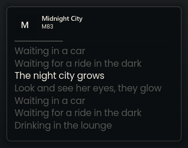
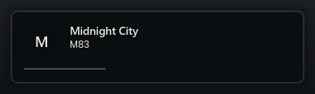
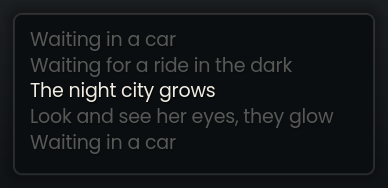
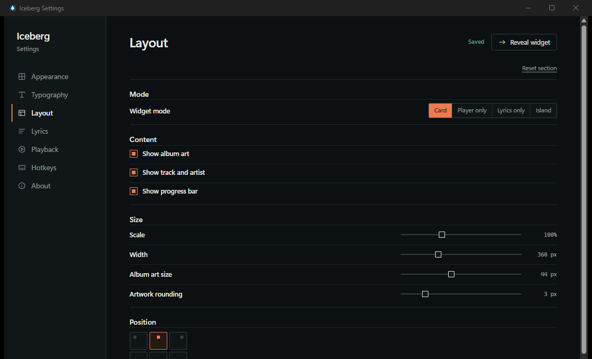

<p align="center">
  
</p>

<h1 align="center">Iceberg</h1>

<p align="center">
  <strong>Now playing, with lyrics that follow.</strong><br>
  A small native widget for Windows. No login, no account, no telemetry.
</p>

<p align="center">
  <a href="https://github.com/h4nxxlmao/iceberg/actions/workflows/ci.yml"></a>
  <a href="LICENSE"></a>
  <a href="https://github.com/h4nxxlmao/iceberg/releases/latest"></a>
  
</p>

<p align="center">
  <a href="#install">Install</a> ·
  <a href="#features">Features</a> ·
  <a href="#screenshots">Screenshots</a> ·
  <a href="#build-from-source">Build</a> ·
  <a href="#privacy-and-security">Privacy</a> ·
  <a href="#contributing">Contributing</a>
</p>

<p align="center">
  
</p>

<p align="center">
  <sub>Card mode at 100% scale. The widget itself is a transparent layered window.</sub>
</p>

Iceberg reads the current track from Windows' media session and fetches synced lyrics from [LRCLIB](https://lrclib.net), with a [lrcmux](https://lrcmux.dev) fallback when LRCLIB is unavailable. It sits on the desktop as a small, frameless widget, follows the song, and stays out of the way. Spotify and Apple Music work without signing in; nothing is scraped from a browser.

## Features

- **A real desktop widget.** Card, Player-only, Lyrics-only, and Island modes, five surfaces (Solid, Transparent, Acrylic, Ice, Liquid), six presets, and per-monitor positions with edge snapping.
- **Your player, not every tab.** Pick Spotify, Apple Music, a custom media app, or Any app. Browser and YouTube sessions are ignored by default.
- **Lyrics that keep up.** Time-synced LRCLIB lyrics, with a lrcmux fallback when LRCLIB is down or has no match. Wrapping, per-track offset, cached results, automatic retry, and a manual "look up again" action.
- **Live customization.** Font, size, weight, color, opacity, alignment, case, spacing, shadow, outline, album art, visible lyric lines, and transition speed. Changes reach the widget immediately.
- **Motion in the right places.** Lyric lines slide and fade, the card scrolls by the outgoing line's real height, and surface, preset, font, and track changes crossfade instead of snapping.
- **Keyboard and tray controls.** Global hotkeys for show/hide, click-through, lyric offset, mode cycling, quick peek, and settings.
- **Quiet by default.** Pause and fullscreen auto-hide, battery saver, reduced motion, click-through, optional start with Windows, and a tray-only mode that creates no window until something plays.
- **Small and private.** The widget is native Rust with no WebView. No polling loop, no telemetry, and no account.

## Screenshots

<p align="center">
  
  
</p>

<p align="center">
  <sub>Player only and Lyrics only. Card and Island are available in the same mode picker.</sub>
</p>



*The settings window is a live preview. It uses WebView2 only while it is open; closing it leaves the widget in the tray.*

## Install

Iceberg runs on Windows 10 and 11 (x64). The settings window needs the Microsoft WebView2 runtime. Windows 11 includes it; the Windows 10 installer can fetch it.

Download **Iceberg 0.2.0** from [Releases](https://github.com/h4nxxlmao/iceberg/releases/tag/v0.2.0). Each release includes SHA-256 checksums.

- The installer is per-user and does not need administrator rights.
- Windows builds are unsigned, so SmartScreen may show an "Unknown publisher" warning. Verify the checksum before choosing **More info → Run anyway**.
- The portable build contains `iceberg.exe`, `iceberg-settings.exe`, the fonts, presets, surface images, and icons.

## Build from source

You need:

- Windows 10 or 11 x64
- Rust 1.90 or newer, with the MSVC toolchain
- Visual Studio 2022 Build Tools with **Desktop development with C++** and the Windows SDK
- Node.js 22 LTS and npm
- WebView2, for the settings window

```powershell
git clone https://github.com/h4nxxlmao/iceberg.git
cd iceberg/app
npm --prefix settings ci
cargo xtask package
```

`cargo xtask package` builds the settings frontend, the release widget and settings executables, the portable folder at `app/dist/Iceberg`, and the NSIS installer under `app/target/release/bundle/nsis`. The first installer build downloads the Tauri NSIS tool.

To run the widget with the built-in demo:

```powershell
cargo run -p iceberg-widget -- --demo
cargo run -p iceberg-widget -- --demo --background=liquid
```

To run the settings window in development:

```powershell
npm --prefix settings run tauri -- dev --no-watch
```

The dev command builds the widget first, so Settings always launches the current native binary.

Before opening a pull request, run:

```powershell
cargo fmt --all --check
cargo clippy --workspace --all-targets -- -D warnings
cargo test --workspace
npm --prefix settings run build
```

More detail is in [CONTRIBUTING.md](CONTRIBUTING.md).

## Performance

Iceberg is event-driven. It does not poll, and it does not render frames while paused, hidden, or idle.

| Measure | Result |
| --- | ---: |
| Idle CPU | 0% |
| Visible with the demo track | 21.2 MB working set / 4.9 MB private |
| Tray only, no window | 3.0 MB working set / 2.8 MB private |
| Widget executable | 3.52 MiB |
| Settings executable | 3.10 MiB |
| NSIS installer | 3.39 MiB |
| Portable ZIP | 4.92 MiB |

These are single 0.2.0 release samples from the build machine, not a guarantee for every desktop. Full renderer measurements and raw results are in [docs/phase-c/RESULTS.md](docs/phase-c/RESULTS.md). The settings window runs in a separate WebView2 process only while it is open.

## Privacy and security

- Iceberg talks to `lrclib.net` over HTTPS, with timeouts and response limits. When LRCLIB is down or has no match, it tries the LRCLIB-compatible endpoint at `api.lrcmux.dev` as a fallback. No other hosts are contacted.
- The widget has no WebView, no remote content, and no analytics. The settings companion loads bundled local assets under a strict CSP and has only Tauri's core permissions.
- Lyrics, titles, artists, and imported font names are treated as untrusted text. Config and font files are validated at the boundary.
- The local settings pipe only changes the widget's appearance. It does not expose files, secrets, network requests, or privilege changes.
- Autostart writes only to the current user's Windows `Run` key and can be turned off in Settings.

Read [SECURITY.md](SECURITY.md) before reporting a vulnerability. Please use GitHub's private vulnerability reporting, not a public issue.

## FAQ

**Do I need a Spotify or Apple Music account?** No. Iceberg reads the Windows media session; it never asks for player credentials.

**Why does it ignore YouTube?** Browser sessions are noisy and usually not what a desktop music widget should follow. Choose **Any app** in Settings if you want them.

**Lyrics are missing for a song.** LRCLIB is a community database, so some tracks have no synced lyrics or only plain text. Iceberg falls back to lrcmux when LRCLIB is down or has no match, retries when both services are overloaded, and explains the real state instead of claiming you are offline. Use **Look up again** in the Lyrics section after a retry.

**Why does SmartScreen warn me?** Release binaries are not code-signed yet. Check the release SHA-256 checksum before running an unsigned build.

**Does Iceberg collect anything?** No telemetry, analytics, crash reports, or accounts.

## Roadmap

The short version is in [docs/ROADMAP.md](docs/ROADMAP.md). The next work is Windows 10 and mixed-DPI validation, a longer leak run, word-level lyric highlighting, and more accurate wallpaper mapping on multi-monitor setups.

## Contributing

Issues and pull requests are welcome. Bug reports get a structured form in [Issues](https://github.com/h4nxxlmao/iceberg/issues/new/choose); feature requests should explain the use case and the performance cost.

Read [CONTRIBUTING.md](CONTRIBUTING.md) for the workspace layout, build commands, performance budget, and commit style. By participating, you agree to the [Code of Conduct](CODE_OF_CONDUCT.md).

The Rust widget keeps a hard budget: under 10 MB when tray-only, under 40 MB visible, 0% CPU idle, under 3% during a lyric transition, and an installer under 8 MB. If a change cannot fit, make it opt-in or leave it out.

## License

Iceberg is free software under the **GNU General Public License, version 3 only** (`GPL-3.0-only`). Copyright (C) 2026 h4nxxlmao. See [LICENSE](LICENSE) for the full terms.

The bundled fonts are under the SIL Open Font License; their licenses and sources are in [app/assets/fonts](app/assets/fonts/README.md).

## Acknowledgements

Lyrics come from [LRCLIB](https://lrclib.net), with a fallback through [lrcmux](https://lrcmux.dev). The settings shell uses [Tauri](https://tauri.app), and the native text renderer uses [cosmic-text](https://github.com/pop-os/cosmic-text) and [swash](https://github.com/dfrg/swash). Iceberg is not affiliated with Spotify, Apple, LRCLIB, or lrcmux.
